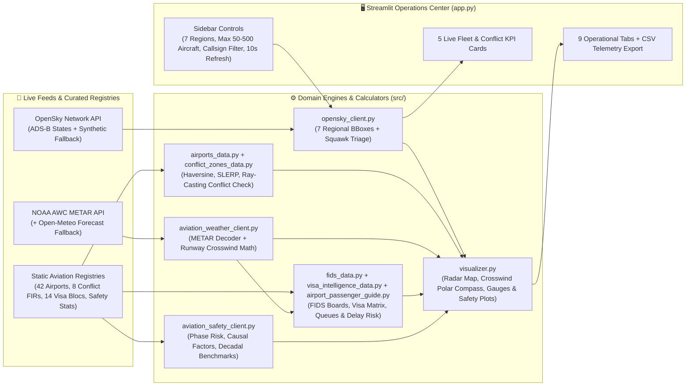

<h1 align="center">✈️ Global Flight Radar &amp; Aviation Intelligence Platform</h1>

<p align="center">
  <strong>An interactive Streamlit and Plotly aviation operations platform combining live OpenSky Network ADS-B radar telemetry, EASA/FAA conflict-airspace route interception, NOAA/Open-Meteo METAR runway crosswind analysis, FIDS airport boards, visa entry matrices, delay risk modeling, and flight safety analytics.</strong>
</p>

<p align="center">
  <a href="#-executive-overview"><b>Overview</b></a> •
  <a href="#-operational-modules-and-dashboard-tabs"><b>Modules</b></a> •
  <a href="#-analytical-and-geodesic-risk-models"><b>Models &amp; Math</b></a> •
  <a href="#-system-architecture"><b>Architecture</b></a> •
  <a href="#-repository-structure"><b>Structure</b></a> •
  <a href="#-installation-and-usage"><b>Quickstart</b></a> •
  <a href="#-data-providers-and-reference-registries"><b>Data Sources</b></a>
</p>

<p align="center">
  
  
  
  
</p>

<p align="center">
  
  
  
  
</p>

---

## 🌐 Executive Overview

**Global Flight Radar & Aviation Intelligence Platform** unifies real-time airspace situational awareness, flight corridor planning, aerodrome meteorology, passenger terminal intelligence, and commercial safety analytics inside a dark-themed Streamlit dashboard (`app.py`).

Built for aviation analysts, dispatch researchers, travel-risk monitors, and aerospace enthusiasts, the platform operates over **public, zero-key REST feeds** (with resilient local/synthetic fallbacks when rate-limited) and pairs a **10-second `streamlit_autorefresh` telemetry loop** with geodesic routing and polygon conflict-interception checks across **42 international airport hubs** (`src/airports_data.py`) and **8 active conflict airspace polygons** (`src/conflict_zones_data.py`).

---

## 🧭 Operational Modules and Dashboard Tabs

`app.py` presents **5 live KPI cards** (Active Aircraft, Emergency Transponders `7700`/`7600`/`7500`, Average Fleet Altitude & Flight Level, Average Ground Speed in `kts`/`km/h`, and Monitored Conflict Zones) above **9 operational tabs**:

| Tab | Module | Core Implementation | Key Outputs & Capabilities |
|---|---|---|---|
| **1** | `🛰️ Live Flight Radar (ADS-B)` | `OpenSkyClient.fetch_live_flights` + `create_flight_radar_map` | Interactive Natural Earth radar plotting live positions, altitudes, speeds, headings, climb/descent phases, conflict polygons, emergency squawk alerts (`7700`/`7600`/`7500`), and CSV download (`live_flight_radar.csv`). |
| **2** | `📺 Live Airport FIDS Boards` | `FIDSManager.generate_fids_boards` | Synchronized 5-minute rotating departure/arrival terminal monitors (16 flights each across 13 airlines & 15 destination hubs) with gates, terminals, baggage belts, and delay tags. |
| **3** | `🛂 Visa & Passport Entry Guide` | `VisaIntelligenceEngine.get_visa_requirement` | Bilateral visa status, max stay, fee estimates, processing timelines, 6-month passport validity check, and mandatory document checklist across `14` curated countries/blocs (`COUNTRIES_LIST`) with smart fallback rules. |
| **4** | `⏱️ Airport Wait Times & Delay Engine` | `AirportPassengerGuide` + `AviationWeatherClient` | International/Domestic terminal queue breakdown (check-in, security, passport control, gate walk, boarding cutoffs), cabin baggage/liquid rules, and METAR-driven delay probability gauge (`0–100%`). |
| **5** | `⛔ Conflict Airspaces & War Zones` | `CONFLICT_ZONES_DATABASE` (`src/conflict_zones_data.py`) | Detailed dossier for `8` monitored conflict airspaces (`UKRAINE_WAR_ZONE`, `RED_SEA_YEMEN`, `LEVANT_SYRIA_IRAQ`, `IRAN_STRAIT_OF_HORMUZ`, `SUDAN_CIVIL_WAR`, `SAHEL_INSURGENCY`, `TAIWAN_STRAIT`, `KOREAN_DMZ`) with Risk Codes `1–3`, FIR codes, and advisories. |
| **6** | `🧭 Flight Route Planner & Conflict Checker` | `airports_data.py` + `check_flight_path_conflicts` | Computes great-circle distance (`NM` & `km`), flight time, cruise altitude (`FL280`/`FL360`), fuel & $\text{CO}_2$ burn, 75-waypoint SLERP trajectory, and direct intersection / `<350 km` proximity warnings against conflict zones. |
| **7** | `🛫 Airport Hubs & METAR Weather` | `AviationWeatherClient` + `create_runway_crosswind_compass` | Live NOAA METAR (with Open-Meteo & nominal fallbacks), `VFR`/`MVFR`/`IFR`/`LIFR` classification, temperature/dew point, QNH altimeter, and polar runway alignment vs. headwind/crosswind vector compass. |
| **8** | `⚠️ Aviation Accidents & Safety Intelligence` | `AviationSafetyClient` + `visualizer.py` | Grouped bar chart of flight phase duration vs. fatal accident share (`Critical 11 Minutes`), causal factor donut (`LOC-I`, `CFIT`, Weather, Runway, Mechanical), 1970–2026 fatal rate evolution, and 4 landmark case studies (`MH17`, `AF447`, `US1549`, `SQ321`). |
| **9** | `🌪️ Severe Turbulence & Airspace Hazards` | Built-in operational reference panel | Analytical briefing on **Clear-Air Turbulence (CAT)** near >100 kt jet streams, **Convective Storm Updrafts** (20 NM lateral separation), and **Mountain Wave & Wake Turbulence** (4–8 NM separation). |

---

## 📐 Analytical and Geodesic Risk Models

1. **Great-Circle Distance (Haversine)** (`calculate_great_circle_distance` in `src/airports_data.py`):
   $$d = 2R\operatorname{atan2}\!\left(\sqrt{a},\sqrt{1-a}\right), \qquad a = \sin^2\!\left(\frac{\Delta\phi}{2}\right) + \cos\phi_1\cos\phi_2\sin^2\!\left(\frac{\Delta\lambda}{2}\right)$$
   Evaluated with $R_{\text{km}} = 6371.0\ \text{km}$ and $R_{\text{NM}} = 3440.065\ \text{NM}$.

2. **Spherical Linear Interpolation (SLERP) Waypoints** (`generate_great_circle_path`):
   Interpolates `num_points = 75` intermediate geodesic points along angular distance $\delta$ for fraction $f \in [0, 1]$:
   $$A(f) = \frac{\sin((1-f)\delta)}{\sin\delta}, \qquad B(f) = \frac{\sin(f\delta)}{\sin\delta}, \qquad \mathbf{p}(f) = A(f)\mathbf{p}_1 + B(f)\mathbf{p}_2$$

3. **Flight Duration, Fuel & $\text{CO}_2$ Estimator** (`estimate_flight_metrics`):
   $$t_{\text{air}} = \frac{D_{\text{NM}}}{460.0} + 0.58\ [\text{hrs}], \qquad F_{\text{tonnes}} = \frac{D_{\text{km}} \times 3.4}{1000}, \qquad \text{CO}_2 = 3.16 \times F_{\text{tonnes}}$$

4. **Conflict Corridor Interception** (`point_in_polygon` & `check_flight_path_conflicts` in `src/conflict_zones_data.py`):
   Applies a ray-casting point-in-polygon test to every interpolated waypoint $(\phi_i, \lambda_i)$ against each zone polygon, flagging `DIRECT_INTERSECTION` when inside or `NEARBY_PROXIMITY` when minimum vertex distance $d_{\text{km}} \approx 111.0 \cdot \Delta_{\text{deg}} < 350.0\ \text{km}$.

5. **Runway Headwind & Crosswind Vector Decomposition** (`calculate_runway_crosswind` in `src/aviation_weather_client.py`):
   $$\Delta\theta = \big((\theta_{\text{wind}} - \theta_{\text{rwy}}) \bmod 360\big) \in (-180^\circ, 180^\circ]$$
   $$V_{\text{headwind}} = V_{\text{wind}}\cos(\Delta\theta), \qquad V_{\text{crosswind}} = V_{\text{wind}}\sin(\Delta\theta)$$

6. **Weather-Driven Flight Delay Risk** (`predict_flight_delay_probability` in `src/airport_passenger_guide.py`):
   Computes $\min(95.0,\ P_0 + \Delta_{\text{vis/cat}} + \Delta_{\text{xwind}} + \Delta_{\text{wind}})$ from a $12.0\%$ baseline using `LIFR` ($+55\%$), `IFR` ($+35\%$), `MVFR` ($+18\%$), crosswind bands (`>28 kts` $+45\%$, `>20 kts` $+22\%$, `>14 kts` $+10\%$), and surface wind (`>35 kts` $+20\%$).

---

## 🏗️ System Architecture



---

## 📂 Repository Structure

```text
aviation-intelligence-platform/
├── src/
│   ├── __init__.py                   # Package initialization (__version__ = "1.0.0")
│   ├── airport_passenger_guide.py    # Terminal wait-time estimator & weather-driven delay probability model
│   ├── airports_data.py              # 42 global airport hubs, Haversine distance, SLERP path & fuel/CO2 math
│   ├── aviation_safety_client.py     # Phase-of-flight risk, causal factors, 1970-2026 trends & case studies
│   ├── aviation_weather_client.py    # NOAA METAR + Open-Meteo fallback client & runway crosswind vector math
│   ├── conflict_zones_data.py        # 8 CZIB conflict airspace polygons & ray-casting corridor interceptor
│   ├── fids_data.py                  # Deterministic 5-minute window airport FIDS departure & arrival boards
│   ├── opensky_client.py             # OpenSky Network ADS-B REST client, 7 regional boxes & fallback feed
│   ├── visa_intelligence_data.py     # 14-country/bloc visa rules matrix & mandatory entry document guide
│   └── visualizer.py                 # 6 Plotly charts (radar map, polar crosswind compass, safety & gauges)
├── .gitattributes                    # Git LF line-ending normalization
├── .gitignore                        # Python, venv, and .env ignore rules
├── app.py                            # Main Streamlit dashboard application (9 tabs)
├── LICENSE                           # Apache License 2.0
├── README.md                         # Project documentation
└── requirements.txt                  # Python package dependencies
```

---

## 🚀 Installation and Usage

### Prerequisites
- **Python**: `3.10` or higher.
- **Git** *(optional, for cloning)*.

### 1. Clone the Repository
```bash
git clone https://github.com/khalid-naami/aviation-intelligence-platform.git
cd aviation-intelligence-platform
```

### 2. Create & Activate a Virtual Environment
```powershell
# Windows PowerShell
python -m venv .venv
.\.venv\Scripts\Activate.ps1
```

```bash
# macOS / Linux
python3 -m venv .venv
source .venv/bin/activate
```

### 3. Install Dependencies
```bash
pip install -r requirements.txt
```
Dependencies in `requirements.txt`: `streamlit>=1.35.0`, `pandas>=2.0.0`, `numpy>=1.24.0`, `requests>=2.31.0`, `plotly>=5.18.0`, `scipy>=1.11.0`, `streamlit-autorefresh>=1.0.1`.

### 4. Launch the Application
```bash
streamlit run app.py
```
The dashboard launches at `http://localhost:8501`. No API keys or `.env` configuration are required.

### Sidebar Controls & Coverage Regions
- **Radar Coverage Region** (`REGIONS` in `src/opensky_client.py`): `Worldwide`, `North Africa & Mediterranean`, `Middle East & Arabian Gulf`, `Western & Central Europe`, `North America`, `East & Southeast Asia`, and `Conflict Airspaces (Eastern Europe & Middle East)`.
- **Max Tracked Aircraft**: `50` to `500` flights per scan (default `250`).
- **Callsign Filter**: Instant substring match (e.g., `RAM402`, `UAE101`, `BAW22`).
- **10s Auto-Refresh**: Live telemetry toggle via `st_autorefresh` plus manual scan button.

---

## 📡 Data Providers and Reference Registries

| Source / Module | Type | Purpose |
|---|---|---|
| **OpenSky Network (`opensky-network.org/api/states/all`)** | Live REST API *(with realistic fallback)* | Real-time ADS-B aircraft coordinates, barometric altitude, ground speed, heading, vertical rate, and squawk codes. |
| **NOAA Aviation Weather Center (`aviationweather.gov/api/data/metar`)** | Live REST API | Official aerodrome METAR reports (`rawOb`, wind, visibility, QNH altimeter, flight category). |
| **Open-Meteo Forecast (`api.open-meteo.com/v1/forecast`)** | Live REST API *(secondary fallback)* | High-resolution airport meteorological fallback when NOAA METAR is unavailable for a given ICAO code. |
| **Curated Operational Registries (`src/*.py`)** | Local Domain Datasets | 42 global airports (`AIRPORTS_DATABASE`), 8 EASA/FAA CZIB-inspired conflict polygons (`CONFLICT_ZONES_DATABASE`), 14-country/bloc visa rules (`VISA_RULES_MATRIX`), simulated terminal FIDS boards (`FIDSManager`), and ICAO/IATA/Boeing-modeled safety statistics (`AviationSafetyClient`). |

---

## ⚠️ Operational Disclaimer & License

- **Aviation Safety Notice**: This platform is built for analytical visualization, situational awareness, and educational exploration only. Operational flight planning, dispatch releases, NOTAM compliance, and inflight routing decisions must strictly rely on certified airline dispatchers, Air Traffic Control (ATC), and official Aeronautical Information Publications (AIP).
- **License**: Licensed under the **Apache License, Version 2.0** — see [LICENSE](LICENSE) for full terms.
